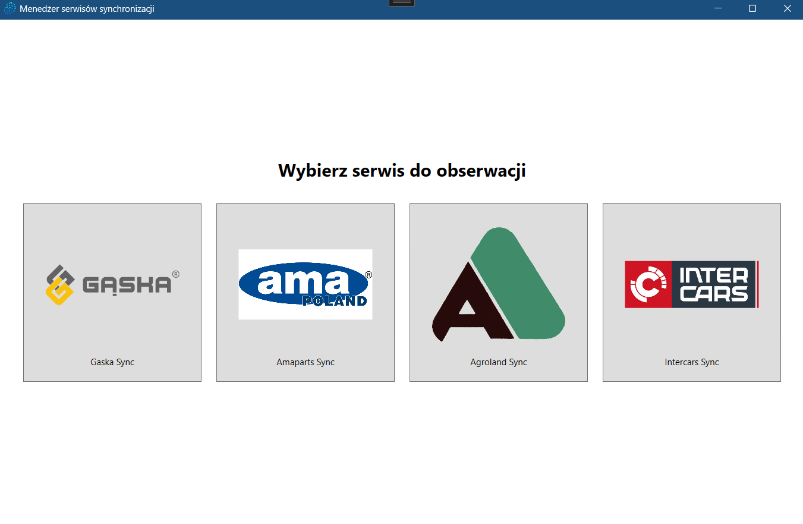
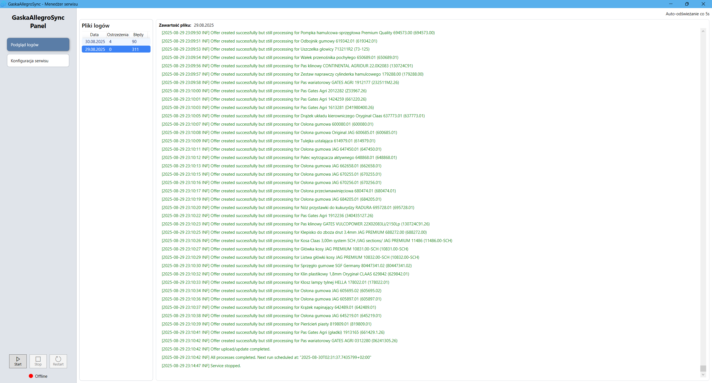
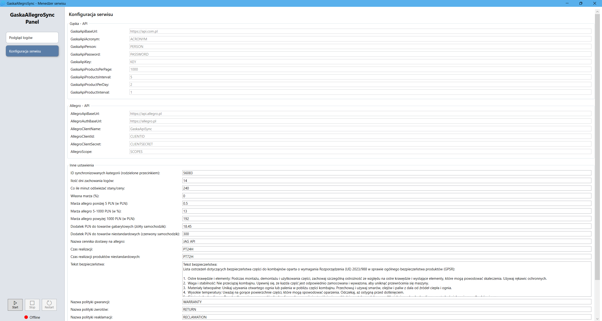

# TechagroSyncServices

> 💼 **Commercial Project** — part of a private or client-facing initiative.

## Overview

**TechagroSyncServices** is a set of Windows Services that integrate with multiple supplier APIs to automatically fetch data and insert it into a database.  
Each service is independently responsible for processing a different supplier’s API and is fully logged using **Serilog**.

Additionally, the project includes a **Manager** (`TechagroSyncServices.Manager`), a user-facing interface that allows users to:

- Select which service they want to observe
- View structured logs in real-time
- Start, stop, or restart services
- Monitor service status
- View or modify service configuration settings

This makes monitoring and managing all services simple and intuitive.

## Features

- Automated supplier data synchronization
- Format-specific parsing (JSON, XML, CSV, GraphQL)
- Live prices and stock only for products from the import list
- Deleting products withdrawn by the supplier, resistant to network and API errors
- New products e-mail notifications
- Structured logging with **Serilog**
- Unit and integration tests

## Services

| Service | Supplier data source | Format | Code in database | Products synced |
|---|---|---|---|---|
| **GaskaSyncService** | Gąska API (paged, max 1 request / 60 s) | JSON | supplier code | whole offer |
| **AgrolandSyncService** | Agroland API | XML | EAN | whole offer |
| **AmapartsSyncService** | Ama-parts CSV files from their website | CSV | supplier code | import list |
| **IntercarsSyncService** | Inter Cars CSV files from their website | CSV | supplier code | import list |
| **AgroramiSyncService** | Agrorami GraphQL API, queried by SKU | JSON | `<sku>AR` | import list |
| **HermonSyncService** | Hermon FTP (offer, images) + Hermon API (prices, stock) | CSV, JSON | `<code>HR` | import list |
| **RolmarSyncService** | Rolmar API | JSON | supplier code | import list |
| **RolnexSyncService** | Rolnex API | JSON | `RL<id>` | import list |
| **AgrobisSyncService** | Agrobis API (paged) | JSON | `AB<index>` | import list |
| **GranitSyncService** | Granit API, live prices and stock | JSON | supplier code | import list |
| **KrampSyncService** | Kramp API, live prices and availability (daily request limit) | JSON | `<sku>KR` | import list |

Additional projects:

- **TechagroSyncServices.Shared** – code used by every service: product synchronization, safe deletion, import list reading, code affixes, new products notifications, SQL procedures
- **TechagroSyncServices.Manager** – WPF application for monitoring and configuring the services
- **TechagroSyncServices.Tests** – unit and integration tests (MSTest)

## How synchronization works

Every service runs on a timer (`FetchIntervalMinutes`) and in each run:

1. **Reads the import list** – `Import/numery_katalogowe.txt` with catalogue codes to synchronize (one per line).
   Codes can be written with or without the supplier affix (e.g. `12345` and `12345AR` mean the same product).
2. **Fetches products** – live services (Agrorami, Granit, Kramp, Hermon) ask the API only for products from the import list,
   catalog services download the whole offer and filter it.
3. **Reports new products** once a day – e-mail with new products and a CSV file in `Export/Nowe`.
   E-mail errors never stop the synchronization, the report is repeated in the next run.
4. **Deletes products** that are no longer in the import list or are no longer returned by the supplier (see below).
5. **Inserts or updates products** – prices, stock, descriptions, images and barcodes.
   Data the supplier does not send (name equal to the code, weight, description, categories, brand, barcodes, images)
   never overwrites values filled in manually in the database, e.g. Kramp and Granit send only prices and stock.

### Supplier code affixes

Codes of some suppliers get a suffix (`AR`, `HR`, `KR`) or a prefix (`AB`, `RL`), so codes of different suppliers never collide.
The affix is removed before calling the API and added before saving to the database (`Indeks_katalogowy` is cut to 20 characters).
A code that naturally starts or ends with the affix has to be written in the import list together with the affix.

### Safe deletion

A product missing in the API response is deleted only when:

- the fetch was complete – any network error, failed page or failed batch skips deleting missing products,
- the API returned anything at all and the number of missing products looks sane (`MaxMissingProductsPercent`, a few products are always allowed),
- the product was missing in `MissingRunsBeforeDelete` complete runs in a row (counters are kept in `Data/missing-products.json`).

Products removed from the import list are always deleted. Prices and barcodes are deleted together with the product.
Only articles created by the service are deleted (`POLE1` of the supplier, sync warehouses) - an article with the same code
created by hand or by another supplier is never touched. Agrorami express variants (`-EXP`) are deleted when Agrorami stops offering express shipping.

## Configuration

Each service has its own `App.config` (not stored in the repository because of credentials).
Supplier API settings are described in the Manager. Common settings:

| Key | Description | Default |
|---|---|---|
| `FetchIntervalMinutes` | Interval between synchronization runs | – |
| `DefaultMargin`, `MarginRanges` | Margin added to purchase prices | 25 |
| `SellPriceRoundingStep` | Sale prices are rounded to this step, set it the same as rounding of price types in WAPRO (`0.01`, `0.10`, ...) | 0.01 |
| `EmailsToNotify`, `Smtp*` | Recipients and SMTP server for new products e-mails, empty = no e-mails | – |
| `LogsExpirationDays`, `FilesExpirationDays` | How long logs and exported files are kept | –, 31 |
| `MaxMissingProductsPercent` | Max percent of products deleted at once because the API stopped returning them | 20 |
| `MissingRunsBeforeDelete` | How many runs in a row a product must be missing before it is deleted | 2 |

### Database

Stored procedures used by the services are in `TechagroSyncServices.Shared/SQL` and have to be deployed to the database
after every change (`UpsertProducts`, `UpsertProduct`, `DeleteNotSyncedProducts`, `GetProductCodes`, ...).

Products are saved in batches of 500 with `UpsertProducts` (one call and one transaction per batch), and rows are written
only when something really changed. When a batch fails, e.g. because of one product with wrong data, its products are saved
one by one with `UpsertProduct`, so only the wrong ones are skipped. Deleting works the same way: batches of 500 products,
one by one only when a batch fails. When the database is unavailable, the batch is skipped instead of trying every product.

## Tests

```bash
vstest.console.exe TechagroSyncServices.Tests/bin/Debug/net481/TechagroSyncServices.Tests.dll
```

Integration tests create a temporary database from `Integration/Database/Schema.sql` and the procedures from the SQL folder.
They run only when the `TECHAGRO_TEST_SERVER` environment variable holds a SQL Server connection string, e.g.
`Server=localhost\SQLEXPRESS;User Id=sa;Password=...;TrustServerCertificate=True`.

## Screenshots

### Manager - Choosing Service View



### Manager - Log View



### Manager - Settings



## Technologies Used

- **Frameworks:** .NET Framework 4.8.1 (services), .NET 8 WPF (Manager)
- **Languages:** C#
- **Data Sources:** REST and GraphQL APIs, FTP, CSV files
- **Testing:** MSTest
- **Database:** SQL Server
- **Logging:** Serilog

## License

This project is proprietary and confidential. See the [LICENSE](LICENSE) file for more information.

---

© 2025-present [calKU0](https://github.com/calKU0)
